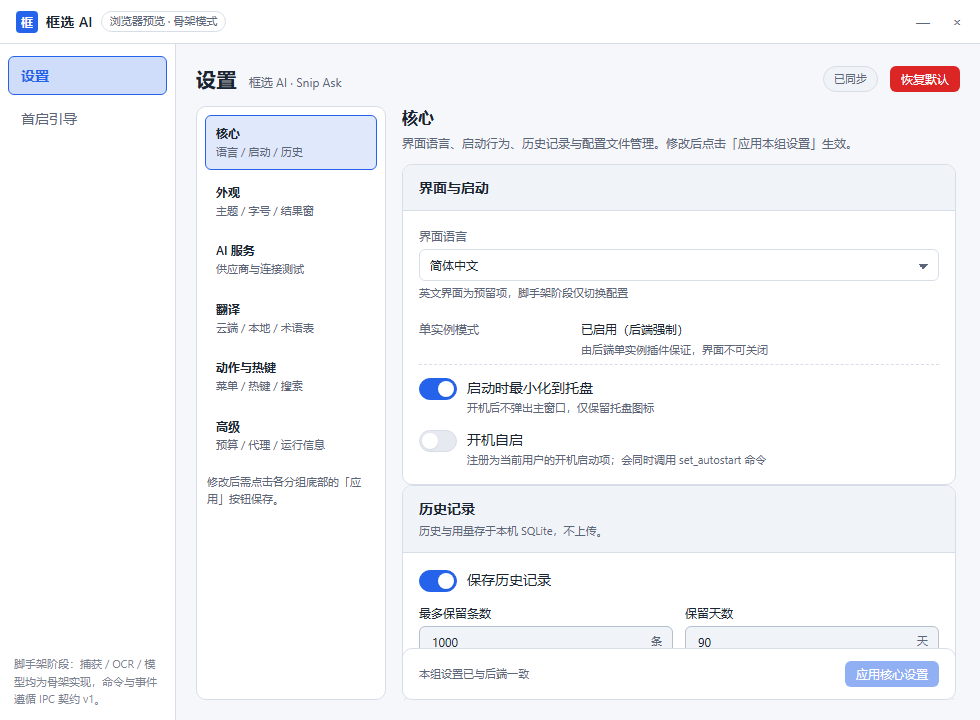
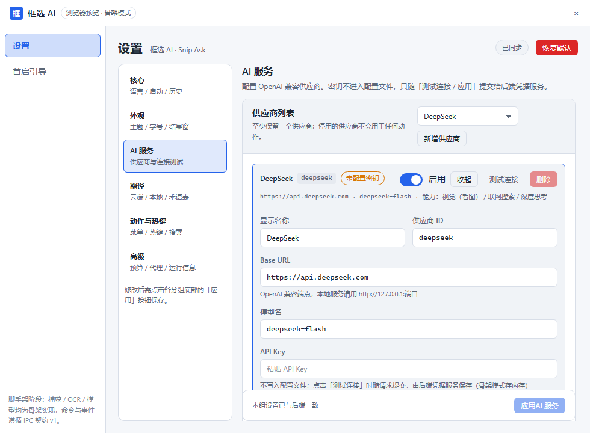
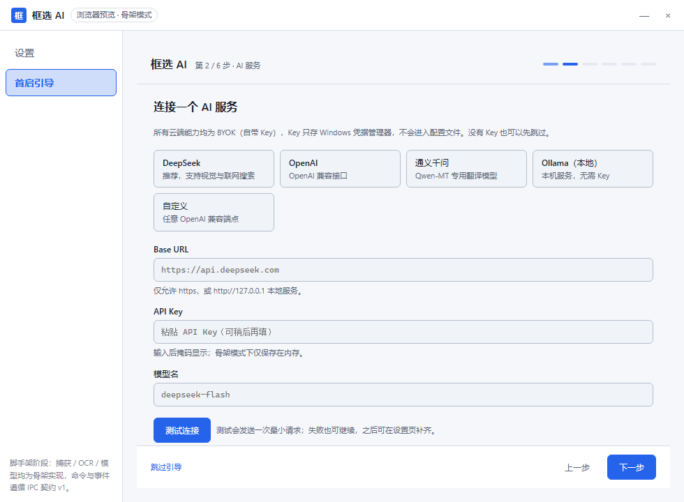
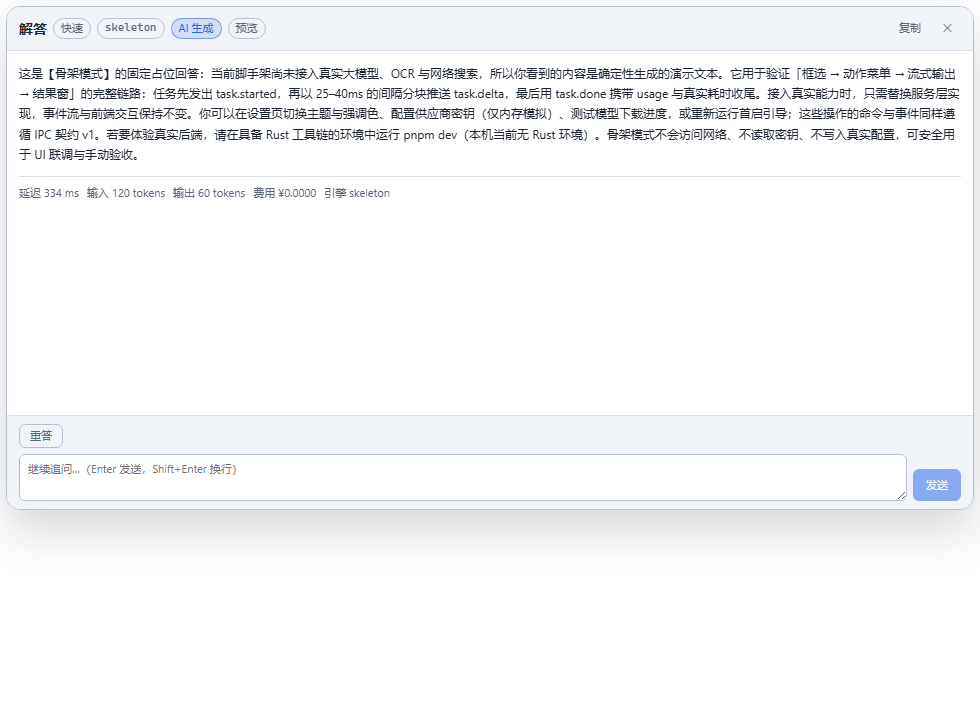
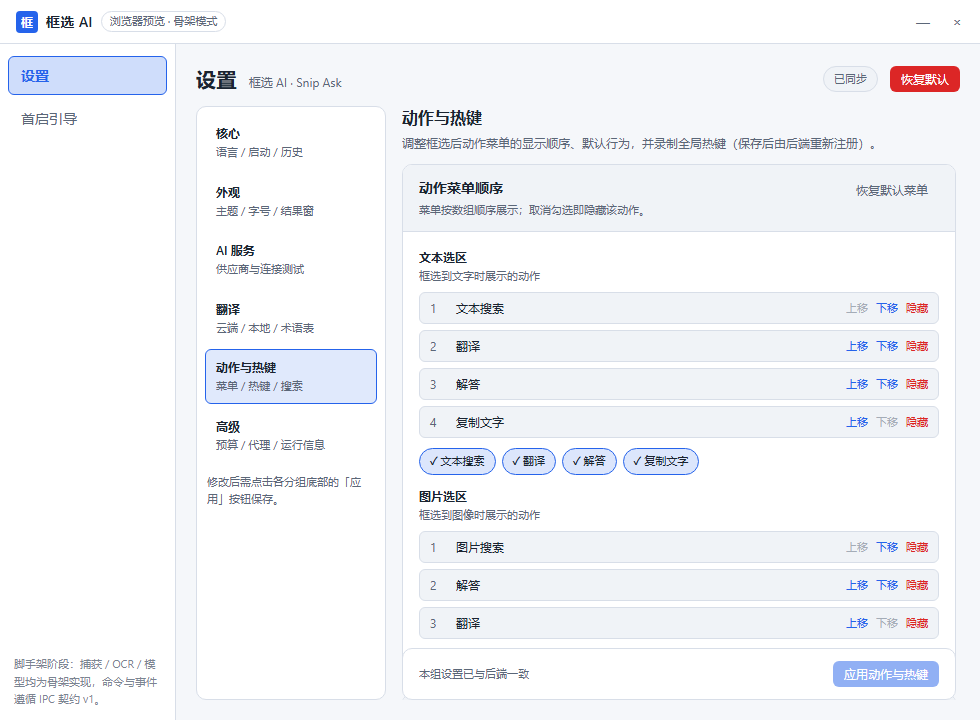
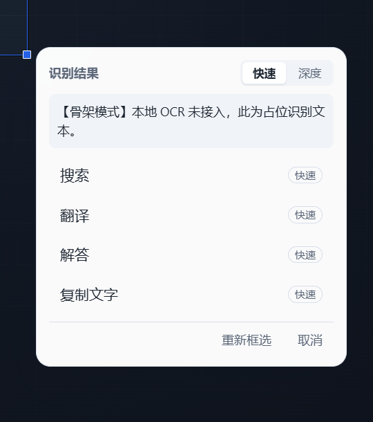
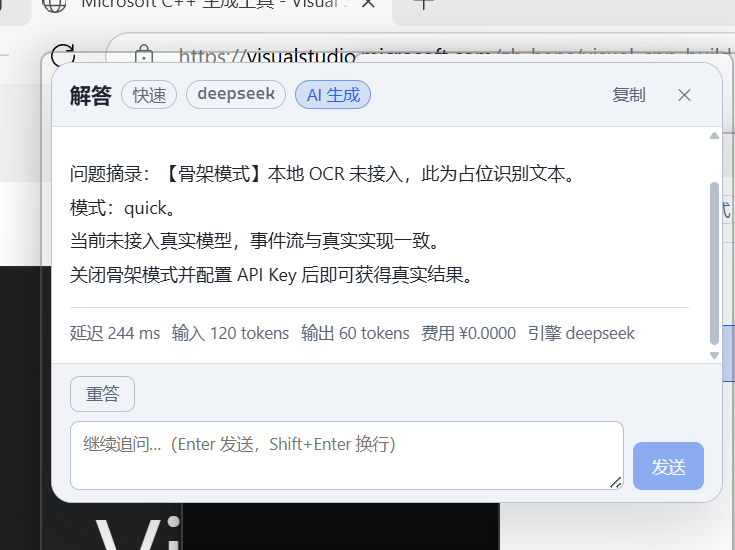

# 框选 AI（Snip Ask）

> 轻量快速、托盘常驻、可开机自启、高度自定义的 Windows 框选解答 / 翻译 / 搜索工具。
> 按 `Ctrl+Q` 冻结屏幕 → 框选任意区域 → 搜索 / 翻译 / 解答，结果以流式输出秒级呈现。

[](LICENSE)


**框选 AI** 是 BYOK（Bring Your Own Key）的桌面工具：没有服务端、不收集截图、不做遥测；
用户自备 AI 服务密钥，截图与文本只在用户主动触发云端动作时才发送。开源协议为
[Apache-2.0](LICENSE)。

> **当前状态：基础架构 / 脚手架（v0.1.0）。** 分层结构、IPC 契约、配置中心、骨架模式与三窗口前端
> 已就绪；Win32 捕获、OCR、HTTP 网关、本地推理引擎等真实能力以 trait 桩 + `TODO(real)` 占位，
> 详见下方[当前状态](#当前状态)。

---

## 目录

- [核心交互](#核心交互)
- [界面预览（骨架模式）](#界面预览骨架模式)
- [当前状态](#当前状态)
- [快速开始](#快速开始)
- [仓库结构](#仓库结构)
- [工程约定](#工程约定)
- [文档索引](#文档索引)
- [验收与性能目标](#验收与性能目标)
- [许可与隐私](#许可与隐私)

## 核心交互

按 `Ctrl+Q` 冻结虚拟桌面 → 拖拽框选目标区域（支持方向键微调、回车确认、`Esc` 取消）→
在动作菜单中选择 **搜索 / 翻译 / 解答 / 复制**，结果在结果窗中流式呈现，可追问、重答、复制、关闭。

- **有文字**：菜单提供文本搜索、翻译、解答、复制文字；框选后立即在后台做整屏 OCR 预扫描。
- **无文字 / 图片**：菜单提供图片搜索（视觉识别 → 检索词 → 联网检索 → 带来源结论）、看图解答、翻译。
- **快速 / 深度两档**：按功能与场景切换，快速档低时延低成本，深度档允许更多检索与更长输出。
- **BYOK**：默认 DeepSeek 视觉/搜索能力，翻译可走云端（Qwen-MT）或本地小模型，全部由用户配置。

## 界面预览（骨架模式）

以下截图来自 `pnpm dev:web` 的浏览器 mock 预览（骨架模式下的确定性占位数据，真实后端接入后交互与布局不变）：

| 设置 · 核心 | 设置 · AI 服务 |
| --- | --- |
|  |  |

| 首启引导 · AI 服务（第 2 步） | 结果窗（流式 + 追问） |
| --- | --- |
|  |  |

| 设置 · 动作与热键 |
| --- |
|  |

> 冻结层/选框/放大镜/动作菜单的 overlay 截图未入库（浏览器 mock 的 `?window=overlay` 可直接查看）。

### 真实运行（Release 构建，骨架模式）

以下为 `pnpm build` 产物在 Windows 11（150% 缩放）实机运行时的截图：

| 框选后的动作菜单（真实窗口） | 结果窗（流式输出 + 用量） |
| --- | --- |
|  |  |

## 当前状态

| 层次 | 内容 | 状态 |
| --- | --- | --- |
| 域逻辑 | 会话状态机、选区/坐标换算、文字存在判定、动作注册表、费用估算（纯逻辑 + 单测） | ✅ 已实现 |
| IPC 契约 | 29 命令 / 14 事件 / `AppError` 错误码表 / 配置 Schema v3，TS 与 Rust 双端同构 | ✅ 已实现 |
| 配置中心 | 默认值、深度合并、校验、迁移（v3←v2←v1）、原子写 + `.bak`、`config:changed` 热生效分类 | ✅ 已实现 |
| 骨架模式 | 捕获/OCR/LLM/搜索/翻译/下载/更新按契约 §12 确定性占位，事件流与真实实现一致 | ✅ 已实现 |
| 前端窗口 | `main`（设置页 + 6 步首启引导）、`overlay`（冻结层 + 选框 + 放大镜 + 动作菜单）、`result`（流式输出 + 来源 + 追问） | ✅ 已实现 |
| 工程底座 | 分层目录、内置资源、图标、pnpm 脚本、`scripts/*.ps1`、CI（windows-latest）、ADR | ✅ 已实现 |
| Win32 捕获 | `BitBlt`/WGC 截取虚拟桌面、多屏混合 DPI（`platform::capture`，trait 已定义） | 🟡 `TODO(real)` |
| 本地 OCR | RapidOCR/ONNX 推理、两段式 det/rec、阈值判定接入 | 🟡 `TODO(real)` |
| HTTP 网关 | OpenAI 兼容流式 SSE、DeepSeek Search/Fetch、Qwen-MT、重试与费用计量 | 🟡 `TODO(real)` |
| 本地引擎 | llama.cpp/Ollama 进程管理、健康检查、空闲卸载、模型下载（Range/镜像/SHA256） | 🟡 `TODO(real)` |
| 凭据 / 更新 | Windows Credential Manager 实装、`tauri-plugin-updater` 签名通道 | 🟡 `TODO(real)` |

图例：✅ 脚手架内完整可运行/可测；🟡 接口与骨架就绪，真实能力待接入。逐模块（M01–M20）的
映射与状态见 [`docs/实施架构.md` §6](docs/实施架构.md)。

> 骨架模式下所有外部能力都有确定性占位实现：无网络、无密钥、无本地模型也能完整走通
> 「热键 → 冻结 → 框选 → 菜单 → 流式结果」闭环，便于前后端并行开发与手动验收。
>
> **真实编译/运行验证（2026-11-04）**：Rust 1.99.1 + MSVC 14.51 下 `cargo build` / `cargo test`（148 项）/
> `cargo clippy -D warnings` / `cargo fmt --check` 全部通过；release 应用实机启动并跑通
> 「`Ctrl+Q` → 框选 → 动作菜单 → 流式结果窗」端到端。注意：直接 `cargo build --release` 不会启用
> Tauri 的 `custom-protocol` feature（会退化为连接 devUrl），桌面发布请用 `pnpm build`（或
> `cargo build --release --features custom-protocol`）。

## 快速开始

### 环境要求

| 工具 | 版本 | 说明 |
| --- | --- | --- |
| Windows | 10（1903+）/ 11，x64 | 目标平台 |
| Node.js | ≥ 20（推荐 22 LTS） | 前端构建 |
| pnpm | ≥ 9（仓库按 11 校验） | 包管理，可用 `corepack enable` 启用 |
| Rust | stable（≥ 1.77） | **仅桌面版需要**；通过 [rustup](https://rustup.rs/) 安装 |
| VS Build Tools 2022 | 「使用 C++ 的桌面开发」工作负载 | 提供 MSVC 链接器 `link.exe` 与 Windows SDK |
| WebView2 Runtime | Win11 自带 | Windows 10 由安装器或系统更新安装 |

> 本仓库的开发机可能**未安装 Rust/MSVC**：此时可先用浏览器 mock 预览前端，Rust 侧由 CI
> （windows-latest 上的 fmt/clippy/test）兜底。安装步骤见 [`docs/开发指南.md`](docs/开发指南.md)。

### 安装依赖

```powershell
pnpm install
```

### 浏览器预览（无需 Rust）

```powershell
pnpm dev:web
```

- `http://localhost:1420/`：主窗口（设置页 + 首启引导），mock 后端，数据存 `localStorage`；
- `http://localhost:1420/?window=overlay`：冻结层 + 选框 + 动作菜单；
- `http://localhost:1420/?window=result`：结果窗（流式输出、来源、追问）。

### 桌面版（需要 Rust 工具链）

```powershell
pnpm dev        # tauri dev：Vite 1420 + Rust 后端
pnpm build      # tauri build：生成 NSIS 安装包
```

### 检查与构建

```powershell
pnpm typecheck    # tsc --noEmit
pnpm build:web    # tsc --noEmit && vite build → dist/
pnpm build        # tauri build（需 Rust）

# 一键校验（等价 CI；无 Rust 时自动跳过 Rust 检查并给出提示）
powershell -ExecutionPolicy Bypass -File scripts\verify.ps1
```

辅助脚本：

| 脚本 | 作用 |
| --- | --- |
| `scripts\dev.ps1` | 检测 Node/pnpm/Rust；有 Rust 启动 `pnpm dev`，无 Rust 提示改用 `pnpm dev:web` 并给出安装步骤 |
| `scripts\build.ps1` | `pnpm install` → `pnpm build:web`；有 Rust 时再构建安装包，否则说明跳过原因与产物位置 |
| `scripts\verify.ps1` | Web typecheck/build + Rust fmt/clippy/test；输出 PASS/SKIP/FAIL 汇总，失败退出码 1 |
| `scripts\gen-icons.py` | 用 Pillow 重新生成 `src-tauri/icons/` 图标并校验尺寸/格式 |

## 仓库结构

```text
框选ai/
├── docs/                     # 设计文档：实施架构、接口契约、开发指南、技术验证清单、ADR
├── resources/                # 编译内嵌资源：prompts/*.md、models.manifest.json、pricing.json
├── scripts/                  # dev/build/verify.ps1 + gen-icons.py
├── .github/workflows/ci.yml  # CI：Web 检查/构建 + Rust fmt/clippy/test（windows-latest）
├── index.html                # 单入口，按 ?window= 分发（main/overlay/result）
├── package.json / pnpm-lock.yaml
├── src/                      # React 18 + TS + Vite 前端（WebView2 内运行）
│   ├── app/                  # 窗口分发、错误兜底、IPC 事件 hook
│   ├── shared/               # contract（类型/命令名/默认值）、ipc（tauri/mock）、theme、util
│   ├── styles/               # tokens.css（契约 §14）+ base.css
│   ├── components/ui/        # 通用展示组件
│   └── windows/              # main（设置/引导）、overlay（框选/菜单）、result（结果窗）
└── src-tauri/                # Rust 后端（Tauri 2）
    ├── src/contract/         # 对外契约结构（错误/类型/配置/事件/常量）
    ├── src/app/              # 生命周期、AppState、托盘、窗口、热键
    ├── src/commands/         # 29 个 Tauri 命令（薄层：校验 → service → 返回）
    ├── src/domain/           # 纯逻辑（无 IO，可单测）
    ├── src/services/         # 能力编排（trait 注入，骨架模式可替换）
    ├── src/platform/         # 唯一允许 unsafe/Win32 的适配层
    ├── src/events/           # 强类型事件发送助手
    ├── src/resources/        # include_str! 内嵌仓库 resources/
    ├── migrations/           # SQLite 初始 Schema
    └── icons/                # 应用图标（由 scripts/gen-icons.py 生成）
```

完整目录树、分层规则与模块映射见 [`docs/实施架构.md`](docs/实施架构.md) §2–§6。

## 工程约定

1. **契约优先**：`docs/接口契约.md` 是前后端边界的唯一事实来源。新增/修改命令或事件必须先改契约，
   再同步 `src/shared/contract/*` 与 `src-tauri/src/contract/*`，递增 `IPC_CONTRACT_VERSION`（当前 `1`），
   并在契约修订记录中注明。流程见 [`docs/开发指南.md`](docs/开发指南.md)「契约变更流程」。
2. **分层依赖单向**：`commands → services → domain`，`platform` 只被 `services` 调用，
   `contract` 不依赖任何内部模块；`domain` 不得出现 Tauri、文件/网络 IO、`std::process`。
3. **错误模型统一**：命令一律返回 `Result<T, AppError>`，`AppError { code, message, detail, retryable, fallback[], context }`；
   错误码见契约 §8.2，前端按 `fallback` 提供降级按钮，`SA-1099` 静默处理。
4. **无密钥穿越边界**：任何命令入参/出参、事件载荷不得出现明文 API Key；`ConfigView` 只回掩码与 `hasKey`；
   密钥仅存 Windows 凭据管理器，日志禁止记录密钥、OCR 原文与完整查询串。
5. **坐标全程物理像素**：`rectPhys` 以虚拟桌面左上角为原点（可为负），前端不得换算后回传逻辑坐标。
6. **骨架模式默认开启**：`advanced.skeletonMode = true`，外部能力一律走确定性占位实现；
   真实实现以 `// TODO(real): ...` 标注并保持同一 trait。
7. **代码风格**：Rust 用 `cargo fmt` + `cargo clippy -D warnings`，TS 严格模式 + Prettier；
   单文件 ≤ 300 行，单一职责，文件命名见开发指南「代码风格」。

## 文档索引

| 文档 | 说明 |
| --- | --- |
| [`docs/可行性研究报告.md`](docs/可行性研究报告.md) | 需求基线、功能清单、技术选型、成本、合规、验收标准 |
| [`docs/概要设计说明书.md`](docs/概要设计说明书.md) | 总体设计、模块 M01–M20、关键流程、数据设计、性能与安全 |
| [`docs/实施架构.md`](docs/实施架构.md) | 脚手架代码结构、分层规则、运行时形态、模块映射、构建与验证 |
| [`docs/接口契约.md`](docs/接口契约.md) | **IPC 契约 v1**：命令/事件/类型/配置/错误码/骨架模式/主题 token |
| [`docs/开发指南.md`](docs/开发指南.md) | 环境准备、常用命令、契约变更流程、调试、常见问题、代码风格 |
| [`docs/技术验证清单.md`](docs/技术验证清单.md) | 可行性报告「Go 前提条件」与 §3.4 技术难点转成的 spike 任务表 |
| [`docs/adr/`](docs/adr/) | ADR-0001～0005：技术栈、前端无网络密钥、单覆盖层物理像素、契约优先、骨架模式 |
| [`CHANGELOG.md`](CHANGELOG.md) | 版本变更记录 |
| [`LICENSE`](LICENSE) / [`NOTICE`](NOTICE) | Apache-2.0 许可全文 / 第三方组件与模型许可声明 |

## 验收与性能目标

摘自《可行性研究报告》§2.3 与 §7.2（目标值，实际以技术验证与真实环境测试为准）：

| 类别 | 指标 |
| --- | --- |
| 启动与常驻 | 冷启动 ≤ 1.5s；空闲内存 ≤ 120MB；空闲 CPU < 0.5%；托盘常驻 + 单实例 |
| 交互 | 热键 → 选框 ≤ 250ms；动作菜单 ≤ 100ms；多屏混合 DPI 框选坐标误差 ≤ 2px |
| OCR | 整屏文字检测 ≤ 1.2s（4K 双屏，后台不阻塞选框）；选区 OCR ≤ 800ms；准确率 ≥ 95% |
| AI 时延 | 快速模式首字 ≤ 1.5s；AI 搜索首字 ≤ 3s；图片搜索快速模式 ≤ 10s、深度 ≤ 25s |
| 翻译 | 云端 200 字 ≤ 1.5s；本地 1.8B（Q4，CPU）≤ 8s（首次加载另计） |
| 体积 | 主安装包 ≤ 25MB（不含 OCR 模型），含模型 ≤ 60MB；模型按需下载 |
| 引导 | 首启 ≤ 3 分钟完成最小配置；无网络/无 Key 可跳过并进入受限模式；下载支持断点续传 + SHA256 |

可执行的验证任务（负责人、方法、阈值、状态）见 [`docs/技术验证清单.md`](docs/技术验证清单.md)。

**P0 首轮 Spike 实测（2026-11-04/05，骨架模式之上，真实应用/真实模型/真实网络）**：
S-01 混合 DPI 多屏坐标（跨屏误差 0.01px）、S-02 整屏 OCR det（P95 926ms）、S-04 全局热键与冲突、
S-07 离线受限模式、S-08 模型下载断点续传与校验 = **DONE**；
S-03 选区 OCR det+rec P95 968ms（>800ms，**FAILED**；「det 缓存复用 → rec-only」P95 596ms 达标，需架构决策）；
S-05 本地翻译 CPU P50 11.76s（>8s，**FAILED**；云端无 Key **BLOCKED**）；S-06 图片搜索 **BLOCKED**（无 Key）。
逐项记录与原始数据索引见 [`docs/spikes/`](docs/spikes/README.md)，复跑脚本见 [`scripts/spikes/`](scripts/spikes/README.md)。
FAILED/BLOCKED 项需先完成技术方案决策（选区 OCR 口径、本地翻译阈值/GPU、云端 Key 与检索 API）再进入 MVP。

## 许可与隐私

- **许可**：[Apache-2.0](LICENSE)。第三方组件、OCR/推理依赖与模型许可见 [NOTICE](NOTICE)；
  本地翻译模型不随安装包分发，由用户在应用内按需下载，其许可单独标注并遵守模型卡条款。
- **BYOK**：不提供服务端、不代理用户请求、不收集遥测；API Key 仅存 Windows 凭据管理器。
- **隐私**：默认不上传截图；只有用户主动触发云端动作（AI 搜索 / 图片搜索 / 翻译 / 解答）时才发送
  对应文本或图像，且可在设置中分别关闭上传开关；`privacy.localOnly` 可禁用全部云端动作。
- **数据目录**：配置、日志、历史库在 `%APPDATA%\SnipAsk\`，模型与缓存在 `%LOCALAPPDATA%\SnipAsk\`；
  便携版（程序目录存在 `portable.flag`）时写入程序目录旁 `data\`。详见实施架构 §7。
