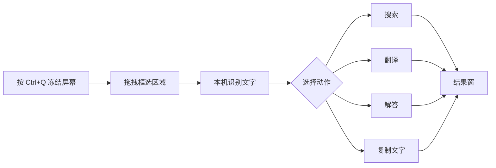

# 框选 AI（Snip Ask）

> 在 Windows 上框选屏幕任意区域，直接 **搜索、翻译或解答**。
> 文字识别在本机完成，AI 可以用云端服务，也可以离线跑本地模型。

[](LICENSE)

[](#下载与安装)

读论文、看代码、看外语网页、玩游戏、处理 PDF 时，框选看不懂的内容，就能得到搜索结果、译文或解释——不用先截图保存，也不用切换窗口。

## 功能

- **框选即用**：默认 `Ctrl+Q` 冻结屏幕，拖拽框选区域，在动作菜单里选择要做什么。
- **五个动作**：
  - **搜索**：把框选内容交给 AI 联网检索并给出结论；
  - **翻译**：生成译文，或以覆盖层按原位置显示译文；
  - **解答**：解释代码、分析图表、总结内容；
  - **复制文字**：只把本地识别出的文字写入剪贴板，不调用 AI；
  - **图片搜索**：以图搜图，只上传你框选的区域，不上传整张桌面。
- **本地文字识别**：RapidOCR（PP-OCRv4）+ ONNX Runtime，截图不出本机；内置模型版把识别模型随包提供，装好即可离线识别。
- **AI 可云端可本地**：支持 DeepSeek、DashScope Qwen-MT 和任意 OpenAI 兼容服务；本地用 llama.cpp（Vulkan / CUDA / CPU 回退）。
- **结果窗**：流式输出，可追问、可重答、可复制；成功任务会写入本机历史，重启后仍可回看。
- **桌面体验**：托盘常驻、单实例、开机自启、全局热键可改，界面支持中文 / 英文。
- **隐私可控**：没有服务端、没有遥测；API Key 只存 Windows 凭据管理器；上传开关可分别关闭，也可以开启「仅本机处理」。

## 使用流程



1. 安装并启动，按首次引导完成语言、AI 服务和热键设置（可以跳过，先用本地功能）；
2. 按 `Ctrl+Q`，拖拽框选屏幕区域（方向键微调、回车确认、`Esc` 取消）；
3. 在动作菜单中选择需要的动作（搜索 / 翻译 / 解答 / 复制文字 / 图片搜索）；
4. 在结果窗查看流式结果，可继续追问、重新回答或复制。

使用云端服务前，需要在「设置 → AI 服务」填入自己的 API Key。不想用云端，可以下载本地模型，或开启「仅本机处理」。

## 下载与安装

发布包在 [`release/`](release/README.md) 目录：

| 版本 | 文件 | 说明 |
| --- | --- | --- |
| 在线版 | [`release/SnipAsk_1.1.0_x64-setup.exe`](release/SnipAsk_1.1.0_x64-setup.exe)（7.46 MiB） | 体积小；首次使用文字识别时下载约 16 MB 模型 |
| 内置模型版 | [`release/SnipAsk_1.1.0_x64-full-setup.exe`](release/SnipAsk_1.1.0_x64-full-setup.exe)（21.56 MiB） | 模型随包，离线开箱即用 |
| 校验和 | [`release/SHA256SUMS.txt`](release/SHA256SUMS.txt) | 下载后建议先校验 |

> 两个版本功能一致，区别只在文字识别模型是否随包。
> 能联网、想要更小的安装包选在线版；离线或内网环境选内置模型版。

**系统要求**：Windows 10（1903+）/ 11 x64，WebView2 运行时（Windows 11 自带），建议 8 GB 以上内存；本地模型对内存和显存有额外要求。

**安装**：

1. （可选）校验安装包：`Get-FileHash .\SnipAsk_1.1.0_x64-setup.exe -Algorithm SHA256`，与 `SHA256SUMS.txt` 中的值比对；
2. 双击安装包完成安装（当前用户安装，不需要管理员权限）；
3. 启动 SnipAsk，按引导完成设置；
4. 按 `Ctrl+Q` 开始框选。

> **未签名提示**：安装包没有代码签名，第一次运行安装包时 Windows SmartScreen 可能提示「Windows 已保护你的电脑」。
> 点击「更多信息 → 仍要运行」即可，并用 `SHA256SUMS.txt` 校验文件完整性。

## 数据与卸载

| 内容 | 位置 |
| --- | --- |
| 配置、提示词、日志、历史库、本地后端 | `%APPDATA%\SnipAsk\` |
| 本地模型、文字识别模型、缓存 | `%LOCALAPPDATA%\SnipAsk\` |
| WebView2 用户数据 | `%LOCALAPPDATA%\com.snipask.app\` |

- **卸载**：在 Windows 设置的应用列表中找到 SnipAsk 并卸载（也可以运行 `%LOCALAPPDATA%\SnipAsk\uninstall.exe`）。卸载时会询问是否同时删除本地数据：删除会清理配置、历史、日志、模型与后端；保留则只删除程序。
- **便携模式**：程序目录下存在 `portable.flag` 时，数据写入程序目录旁的 `data\`。
- **关闭窗口不是退出**：点关闭按钮或按 `Alt+F4` 只是隐藏到托盘，框选热键仍然可用；要彻底退出请用托盘菜单的「退出」。

## 隐私

- **没有服务端**：不上传截图，不收集任何用户信息；没有遥测、崩溃上报、使用统计和更新检查。
- **凭据只在本机**：API Key 保存在 Windows 凭据管理器（service `SnipAsk`），界面只显示掩码。
- **上传可以关掉**：只有你主动使用云端动作（搜索 / 翻译 / 解答 / 图片搜索）时，才会发送对应的文本或图像；可以在「设置 → 隐私」分别关闭文本、图片上传，或开启「仅本机处理」禁用全部云端动作。
- **历史只在本机**：保存在本地 SQLite，可随时清空，不会上传。

## 常见问题

**不用 API Key 能用吗？**
可以先用本地功能：框选、文字识别、复制文字，以及本地模型推理（需要先下载模型）。云端搜索 / 解答 / 翻译需要自备 Key。

**必须联网吗？**
不必。使用内置模型版可以离线完成文字识别；想离线使用 AI，需要先把本地模型下载到本机（之后可断网），在线版则只在首次使用文字识别时需要联网下载约 16 MB 模型。

**为什么关掉窗口后程序还在？**
这是有意设计的：窗口隐藏到托盘，`Ctrl+Q` 始终可用。要退出请用托盘菜单的「退出」。

**怎么升级？**
下载新版安装包覆盖安装即可，配置、提示词、历史和凭据会保留。软件不会自动更新。

**卸载后数据还在吗？**
卸载时会询问是否删除本地数据。如果选择保留，可以手动删除上面「数据与卸载」里的目录，并在 Windows 凭据管理器中删除 `SnipAsk/` 条目。

## 从源码构建

需要：Windows 10 / 11 x64、Node.js ≥ 20、pnpm、Rust stable（≥ 1.77）、VS 2022 Build Tools（MSVC + Windows SDK）、WebView2。

```powershell
pnpm install

pnpm typecheck     # TypeScript 检查
pnpm test          # 前端单测
pnpm build:web     # 构建前端产物

pnpm dev:web       # 浏览器预览（mock 后端，无需 Rust）
pnpm dev           # 桌面开发模式（需要 Rust）
pnpm build         # 构建桌面安装包
```

构建两个版本的安装包：

```powershell
powershell -ExecutionPolicy Bypass -File scripts\fetch-ocr-assets.ps1   # 准备文字识别资产（SHA256 校验）
powershell -ExecutionPolicy Bypass -File scripts\build-installers.ps1  # 构建在线版 / 内置模型版并归档到 release/
```

更完整的说明见 [`docs/开发指南.md`](docs/开发指南.md) 和 [`docs/自定义指南.md`](docs/自定义指南.md)。

## 技术栈

- **前端**：React 18 + TypeScript + Vite，运行在 WebView2；自绘框选层和结果窗，中英双语。
- **后端**：Rust + Tauri 2；Win32 屏幕捕获与剪贴板、全局热键、托盘、单实例。
- **文字识别**：RapidOCR PP-OCRv4（det / rec / cls）+ ONNX Runtime，本地推理。
- **AI 接入**：OpenAI 兼容 SSE 网关；本地 llama.cpp（Vulkan / CUDA / CPU 回退）；DeepSeek、DashScope Qwen-MT 或自定义供应商。
- **存储**：配置和历史保存在本机，凭据保存在 Windows 凭据管理器。

## 仓库结构

```text
src/            React + TypeScript 前端（主窗口 / 框选层 / 结果窗）
src-tauri/      Rust 后端（Tauri 2：捕获、OCR、网关、本地引擎、历史）
resources/      内置提示词、模型清单、定价等资源
scripts/        开发、构建、校验与安装包脚本
docs/           使用说明、架构与接口文档、技术验证记录
release/        发布包、SHA256 校验和与发行说明
```

## 已知限制

- 安装包没有代码签名，SmartScreen 可能提示；请用 SHA256 校验文件。
- 本地 GPU 推理只在 NVIDIA 显卡上验证过；AMD / Intel 显卡未测试（理论上可走 Vulkan）。
- 本地小模型（1–4B）的翻译和解答质量弱于云端大模型，更适合离线或轻量场景。
- 界面支持中文和英文，但个别后端错误信息仍然是中文。
- 尚未在 Windows 10 干净系统、国产杀毒软件环境和更多真实使用场景下做完整验证。

## 文档

| 文档 | 内容 |
| --- | --- |
| [`docs/自定义指南.md`](docs/自定义指南.md) | 使用与自定义：提示词、术语表、配置字段、本地模型与后端替换 |
| [`docs/开发指南.md`](docs/开发指南.md) | 环境准备、常用命令、调试、GPU 与 OCR 调试钩子、安装包构建 |
| [`docs/实施架构.md`](docs/实施架构.md) | 代码结构、分层规则、模块映射、数据与资源 |
| [`docs/接口契约.md`](docs/接口契约.md) | 前后端命令、事件与配置字段契约 |
| [`docs/功能验证清单.md`](docs/功能验证清单.md) | 功能清单与验证记录 |
| [`release/README.md`](release/README.md) | 发布包说明、校验和、安装与卸载 |
| [`CHANGELOG.md`](CHANGELOG.md) | 变更记录 |
| [`SECURITY.md`](SECURITY.md) / [`PRIVACY.md`](PRIVACY.md) | 安全策略 / 隐私说明 |

## 许可

[Apache-2.0](LICENSE)。第三方组件、运行时和模型的许可见 [NOTICE](NOTICE)。

本项目与 DeepSeek、阿里云 DashScope、PaddleOCR 等无隶属关系；API Key 和本地模型由使用者自行提供。
本仓库为开源分享，不承诺固定的更新节奏或长期维护；欢迎提 issue，也欢迎按 Apache-2.0 自行修改和分发。
