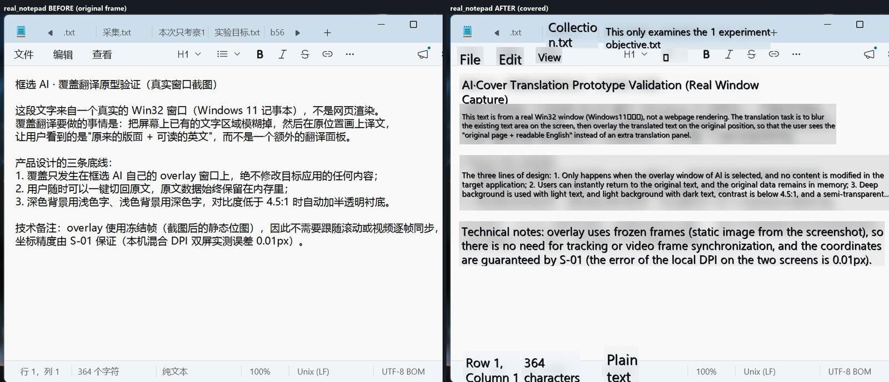

# 追加需求可行性研究（本地 GPU 推理 / 覆盖式翻译 / 连续提问）

> 范围：用户提出的 3 项新需求的技术可行性、实测证据、实现方案、工作量与风险。
> 日期：2026-11-05 ｜ 环境：Windows 11 26200 / i7-12650H（10C16T）/ 15.78 GiB / **NVIDIA RTX 4060 Laptop 8 GB**（驱动 595.97 / CUDA 12）/
> 混合 DPI 双屏（2560×1440@150% + 1080×1920@100%）｜ 构建 `81134d0`。
> 方法：AI 助手团队 3 条并行研究线 + 真实基准/真实截图原型；不接受 mock 充当验收。原始证据见
> `.verify/research/{gpu,overlay,followup}/`（gitignored，含 REPORT/原始 JSON/脚本），本文数字均可从其 summary/报告复核。
> 说明：本文「人日」为估算，前提是复用现有骨架与已有依赖，不含产品设计评审与发版流程。

## 0 结论摘要

| # | 需求 | 可行性 | 推荐方案 | 新增工作量（MVP） | 前置依赖 | 建议 |
| --- | --- | --- | --- | --- | --- | --- |
| 1 | 本地模型走 GPU，设置可选 CPU/GPU | **可行，强烈推荐** | llama.cpp + 显存内全量 offload（`-ngl 99`）；设置新增“计算设备：自动/CPU/GPU” | **MVP-1 ≈4.5 人日；完整 ≈14.5 人日**（含本地引擎欠账 4.0） | 真实本地引擎接入（当前 `TODO(real)`）；GPU 运行时按需下载 | P1（收益最大、风险最低） |
| 2 | 翻译覆盖原句（模糊原区域 + 译文覆盖） | **可行**，仅限「冻结帧覆盖层」形态 | 在现有 overlay 冻结帧上加 Canvas：OCR 段块 → 高斯模糊 + 原位绘制译文；不实时穿透、不修改目标应用 | **≈7.5 人日**（含真机加固 ≈10） | 真实捕获（`dataUrl`）+ 真实 OCR + 翻译链路（当前均为骨架/TODO） | P2（依赖前置能力，先做设计冻结） |
| 3 | AI 回答后继续提问（多轮追问） | **可行且已部分实现，但当前真实链路必失败** | 修 F1 致命缺陷 → 后端注入上一轮问答 → 结果窗改为线程式 UI；二期加 messages 持久化 | **≈6.5–10.5 人日**（最短 4.5–6） | 真实 LLM 网关（`TODO(real)`，3–5 人日，并行） | P0（先修 bug，再补多轮） |

**一句话**：三项都值得做；需求 1 是性价比最高的能力升级（本机实测 **4.4–5.9×** 加速，显存占用 ≤3.7 GB）；
需求 2 技术可行且已有可运行原型，但必须等真实捕获/OCR 接入后才能上生产；需求 3 的 UI/契约/后端骨架已存在，
但**当前真实 IPC 的追问必然返回 SA-1099（任务不存在）**，属于必须先修的缺陷，而不是从零开发。

---

## 1 需求一：本地模型算力走 GPU，设置可选 CPU/GPU

### 1.1 结论

**可行，且本机实测收益显著。** RTX 4060 Laptop 8 GB 可完整承载 0.5B / 1.5B / 1.8B Q4 模型（显存峰值 3 712 MiB，
含桌面基线 2 201 MiB），P95 从 CPU 的 3.2–21.8 s 降到 **0.59–3.75 s**；1.8B 质量档从“CPU 不达标（P95 10.1 s）”
变为“GPU 达标（P95 3.75 s、P50 1.26 s）”，已进入云端同级。CUDA 与 Vulkan 两条后端均可跑，Vulkan 略慢 2–10%
但依赖极小、分发简单。产品侧只需在 `LocalPrefs` 增设备字段、在启动 llama-server 时按选择传
`-ngl`/`--device`，并在失败时自动回退 CPU；设置页「本地翻译」面板加一个“计算设备”选项即可。

### 1.2 实测（真实模型 / 真实 GPU；Q4_K_M，16 线程，200 字，temp 0.2，warmup 2 + N 次）

完整逐次数据见 [GPU 证据报告](research/GPU本地推理-证据报告.md) 与 [data/gpu-summary.json](research/data/gpu-summary.json)。

| 模型 + 提示词 | CPU（实测） | GPU CUDA（`-ngl 99`） | GPU Vulkan | 加速（P50/P95） |
| --- | --- | --- | --- | --- |
| HY-MT 1.8B + 产品 `translate.md` | 同窗 P50 9 767 / P95 10 137 ms（20.6 tok/s）；S-05 历史 11 759 / 21 837 ms | **P50 1 256 / P95 3 747 ms**（n=20，125.7 tok/s） | P50 1 264 / P95 4 081 ms（129.7 tok/s） | **7.8× / 2.7×**（去掉偶发长尾的正常请求 P95 1 290 ms ≈ 7.9×） |
| Qwen2.5-0.5B + 产品提示词 | P50 3 989 / P95 4 111 ms | **P50 579 / P95 591 ms**（227 tok/s） | P50 600 / P95 619 ms | **6.9× / 7.0×** |
| Qwen2.5-0.5B + 极简提示词 | S-05 P95 3 209 ms | P50 692 / P95 733 ms | P50 715 / P95 754 ms | **4.4×** |
| Qwen2.5-1.5B + 极简提示词 | S-05 P50 6 443 / P95 6 723 ms | **P50 1 087 / P95 1 144 ms**（135 tok/s） | P50 1 026 / P95 1 106 ms | **5.9×** |
| prefill（≈流式首字下界） | 1.8B **2 462 ms** | 1.8B **58 ms** | 1.8B 82 ms | **42×**（流式首字预计 <0.2 s） |

**显存与功耗（8188 MiB 卡；桌面空载已占 2 201 MiB / 26.9%，util 29% 来自 Wallpaper Engine 等）**：
模型加载增量 0.5B **+566~573 MiB**、1.5B **+1 226 MiB**、1.8B **+1 498 MiB**（Vulkan 略低 +1 403）；
1.8B 跑满峰值 **3 712 MiB（45.3%），余 4.4 GB → 8 GB 适配**。部分 offload 扫描（1.8B 产品提示词，N=5）：
`-ngl 8` +616 MiB → P50 6.3 s；`-ngl 16` +900 MiB → 4.58 s；`-ngl 24` +1 180 MiB → 2.91 s；`-ngl 99` +1.50 GB → 1.26 s
（部分 offload 有效，但长尾风险陡增，`ngl 8` 单次可达 ~20 s，故降档仅作高级选项）。1.8B 满载 GPU util 82–84%、
61–66 °C、76–85 W（空载 9.8 W / 44 °C）；停止进程后显存回到 2 201 MiB 基线。

**关键工程事实（实测踩坑）**：
- CUDA 缺 runtime DLL 时 `exit -1073741515`（0xC0000135）；**把 `cudart64_12/cublas64_12/cublasLt64_12.dll`
  与 `llama-server.exe` 放同一目录即可，不必改 PATH**（产品按目录布局即可）。
- **必须显式传 `-ngl`**：LM Studio 的 llama.cpp 构建省略 `-ngl` 会默认全量 offload（官方构建省略则=0 层，语义不同）。
- `--device CUDA0/Vulkan0` 与 `--list-devices` 均可用；`--list-devices` 只列物理卡（本机 2 个虚拟显示适配器不会误报），
  是“真能用”的最佳探测判据。
- 后端体量（用于分发）：CPU 16.1 MB、Vulkan 55.8 MB、CUDA 168.5 MB + CUDA runtime 752.4 MB ≈ **0.9 GB**。

### 1.3 设计（最小改动）

1. **配置**（`contract/config.rs` + `src/shared/contract/types.ts`，Schema v3 → **v4**，加默认值与 `migrate_v3_to_v4`；
   兼容分析也给出了「不升版本、靠 serde default」的备选）：
   - `local.device: "auto" | "cpu" | "gpu"`（默认 `auto`）；
   - `local.gpuBackend: "auto" | "cuda" | "vulkan"`（高级，默认 `auto`）；
   - `local.gpuLayers: u32`（默认 99=全部；显存紧张可设 8–24）；
   - `resources/models.manifest.json` 增加 `vramMB`（0.5B=700 / 1.5B=1300 / 1.8B=1600），与 `minRamMB` 并列供预算判定。
2. **引擎启动**：真实 llama.cpp 接入时（当前 `TODO(real)`）按配置拼参数：
   - CPU：`-ngl 0 -t 16`；GPU：`-ngl 99`（或 `gpuLayers`）+ `--device CUDA0|Vulkan0`；
   - 启动后读 `/props`/`--list-devices`/启动日志确认 offload 层数与后端；`/health` 超时 20 s 判失败；
   - 失败链：CUDA → Vulkan → CPU（或启动失败直接 CPU），`engine:status` 携带 `device` 与 `fallbackReason`。
3. **设置 UI**（`settings/sections/TranslateSection.tsx` 本地翻译面板，`:146-185`）：
   - “计算设备：自动（推荐）/ CPU / GPU（推荐）”；
   - 设备状态行：“已检测：NVIDIA RTX 4060 Laptop 8 GB（空闲 7.1 GB，CUDA12 可用）”/“未检测到可用 GPU，将使用 CPU”；
   - 高级：GPU 后端（自动/CUDA/Vulkan）、GPU 层数、显存不足提示与“改用 CPU/切云端”；
   - 保存提示补充“切换计算设备会重启本地引擎”（现有文案已有“切换本地引擎会触发引擎重启”）。
4. **探测与预算**（新增 `platform/gpu.rs`/`local_gpu_probe` 命令）：首选 `<bundled llama-server> --list-devices`
   验证后端真可用；`nvidia-smi` 取物理卡/显存用于展示；DXGI 兜底并过滤虚拟/软件适配器、不把 SharedSystemMemory
   当可用；预算 `need = model.vramMB + 512 MiB`，`free < need` 则 CPU/降档；缓存 60 s。
5. **运行时与分发**（与 S-18 体积门禁的冲突必须处理）：
   - 主安装包（≤25 MiB）**只带 CPU 后端**（16.1 MB 已够）；
   - **Vulkan 后端（55.8 MB）作为默认 GPU 组件按需下载**（跨 NVIDIA/AMD/Intel，无需额外 runtime）；
   - **CUDA 后端（≈0.9 GB）作为 NVIDIA 用户可选组件**（prefill/加载略优）；
   - 复用 S-08 的 Range/断点续传/SHA256/镜像机制，新增 `resources/backends.manifest.json`；CUDA 再分发需遵守 NVIDIA CUDA EULA。
6. **降档与兼容**：显存不足 → 减少 `gpuLayers`（仅高级）、换小模型、或切云端；驱动过旧/无 Vulkan → CPU；
   笔记本默认 `auto`，保留 CPU 选项（省电/续航/发热）与“电池模式自动 CPU”策略。

### 1.4 风险

- **显存竞争**：WebView2/浏览器/游戏会占用显存；8 GB 机型跑 1.8B 尚有余量（峰值 3.7 GB），但 4B 模型（Q4 文件 2.5 GB，
  运行约 3–4 GB）+ 游戏可能不够 → 默认只推荐 ≤1.8B，4B 标记“需要 8 GB 以上独显”。
- **后端兼容**：CUDA 依赖 NVIDIA 驱动/CUDA runtime（下载大）；Vulkan 覆盖广但驱动质量参差；需自动回退 CPU。
- **分发与体积**：见 1.3-4；不要在 25 MB 主包内塞 CUDA。
- **耗电/发热/噪音**：GPU 推理会唤醒独显（P0→P3），笔记本续航下降；提供 CPU 选项与“电池模式自动用 CPU”。
- **首字时延口径**：本次为非流式基准（TTFT 以 prefill 作下界，1.8B CPU 2 462 ms → CUDA 58 ms，预计流式首字 <0.2 s），
  流式实现后需补测真实 TTFT。
- **S-05 结论更新**：本地 1.8B 在 GPU 下 P95 3 747 ms、P50 1 256 ms，**已进入云端同级**（云端总耗时 P50 1.51 s / P95 1.75 s）；
  “CPU 上 8 s 不可达”的旧结论**只适用于 CPU**；引导页“普通模型质量优先但 CPU 慢”的文案应改为“CPU 慢 / GPU 快（需独显）”。
- **未覆盖**：真实游戏/浏览器占 4–7 GB 显存的抢占、8 GB 内存机、Win10、AMD/Intel 显卡、Optimus 切换、长时温控、
  流式取消后的显存释放（详见证据报告 §13）。
- **进程管理**：研究期间第一版脚本按镜像名 `taskkill` 误杀过其它进程两次（已改为按 PID/进程树）——产品侧也必须按 PID/进程树清理。

### 1.5 工作量

| 层 | 内容 | 人日 |
| --- | --- | --- |
| 配置/契约（Rust） | `LocalDevice`/`gpuLayers`/`gpuBackend`、默认值、校验、v4 迁移、单测 | 1.5 |
| GPU 探测 + 预算 + IPC | `--list-devices`/`nvidia-smi`/DXGI 兜底、虚拟卡过滤、`local_gpu_probe`、契约、缓存、单测 | 2.5 |
| 引擎监督者与回退 | 真实 spawn/health/卸载/进程树清理、`-ngl`/`--device`、CUDA→Vulkan→CPU、`engine:status` | 4.0（其中 GPU 增量 ≈2.0，其余为既有 local 引擎欠账） |
| 前端设置 | 类型/默认值/presets、设备选择+层数+状态+提示、试译联动 | 1.5 |
| 打包/分发 | backends 清单 + 下载/校验/解压、许可证、体积门禁、升级策略 | 2.5 |
| 测试/验证 | 单测 + 集成（有/无 GPU、缺 DLL、显存不足）+ 真机矩阵 | 2.0 |
| 文档/文案 | 契约、设置文案、错误码、FAQ | 0.5 |
| **合计（GPU 增量）** | | **≈14.5** |

**MVP 分三步**：MVP-1（配置 v4 + 手动 device 开关 + 设置项 + `-ngl` 显式 + 失败回退提示）**≈4.5 人日**；
MVP-2（auto 探测 + 显存预算 + 回退链 + Vulkan 按需下载）**+4.5**；MVP-3（CUDA 可选 + `gpuLayers` 降档 + 长尾/温控 + 灰度）**+5.5**。
若只做“能选 CPU/GPU、1.8B 达标”的最小版本，4.5 人日即可见效。

---

## 2 需求二：翻译覆盖原句（模糊原句 + 译文覆盖）

### 2.1 结论

**可行，但只能以“冻结帧覆盖层”实现，不能修改目标应用画面。** 现有架构已经具备关键要素：overlay 已把冻结帧渲染为
``；`selection_commit` 返回的 `SelectionResult.boxes`（`OcrBox { text,
confidence, bbox }`）就是每行文字框；S-01 已把物理像素↔CSS 坐标误差压到 0.01px。在冻结帧上叠一层 Canvas：
**按 OCR 段块模糊原区域 + 原位绘制译文**，即可做到“原版式 + 可读译文”，且不写回其他应用。

### 2.2 原型与实测（真实截图 + 真实 OCR + 本地 0.5B 译文）

原型 6 组（网页/聊天/文档/代码/深色/真实 Win32 记事本 BitBlt 实拍），完整 before/after/boxes 对照见
[覆盖翻译证据报告](research/覆盖翻译-证据报告.md)，精选图在 `docs/research/images/`。真实记事本对照（左：原文；右：模糊后覆盖英文，
可见标题栏/状态栏也被误覆盖——这正是需要“UI 文本过滤”的原因）：

**100 张真实语料（2 288 OCR 行）的版面量化**：

| 指标 | 结果 |
| --- | --- |
| 中→英字符扩张 | P50 **2.46×**（P95 3.59×）；同字号行宽扩张 P50 **1.82×**（P95 2.62×） |
| 行合并 | 2 288 行 → **1 552 段块（−32.2%）**，平均 1.47 行/块，9.3% 为多行块 |
| 段块 + 允许吃已知空白（推荐配置） | 原字号 **18.2%** / 缩小字号 **52.2%** / 换行 2–3 行 **29.6%** / **溢出 0%** |
| 对照 | 逐行+允许空白：字号中位仅 0.61；段块但不吃空白：溢出 38.9%；逐行不吃空白：溢出 42.7% |
| 字号中位（相对源行高） | **0.80**（P10 0.601）；<12 px 占 0.9%、<14 px 占 6.7% → 走降级气泡 |
| 性能 | 渲染 86 块 821 ms（Pillow 参考；Canvas 预期 0.1–0.3 s/100 块）；译文：云端 100 行批处理约 3–4.5 s，本地 0.5B CPU 40–80 s（仅适合 ≤20 行） |

**关键结论**：① 逐行覆盖不可行（字号塌缩、溢出近半）→ 必须先**合并成段块**；② 允许“吃掉行间空白/边缘留白”能显著提高
容纳率（53.5% 的块靠此放下）；③ 需要自适应算法；④ 需过滤窗口边框/标题栏/状态栏等“非内容文本”（原型中可见误覆盖）。

### 2.3 方案比较

| 方案 | 可行性 | 说明 |
| --- | --- | --- |
| **A. 冻结帧覆盖层（推荐）** | ✅ 可行 | 截图后 overlay 上完成；坐标/DPI 已有保障；静态不跟随滚动；DRM 下无冻结帧（S-09 实测黑屏） |
| B. 实时穿透悬浮窗 | ⚠️ 高风险 | 需逐帧截屏+OCR 同步：整屏 det P95 975 ms/帧，滚动/视频必然滞后；仅可作为远期增强 |
| C. 改写目标应用文本 | ❌ 不可行 | 跨进程无通用写入通道，注入/伪造输入不合规且不稳定 |

### 2.4 设计

1. **前端**：新增 `TranslationOverlay.tsx` + `translationLayout.ts`（纯函数，Web Worker 内跑，避免阻塞交互）：
   - 输入：`frame.dataUrl`、段块（`OcrBox[]` 合并后）、译文、`dpr`、源/目标语言；
   - 渲染：Canvas 逐块 `ctx.filter = blur(σ)` + 半透明遮罩 → 自动字号（0.60–1.00×源行高，5% 步长）→ 换行 → 超框降级为双语小气泡；
     深色图用浅字、浅色图用深字，对比度 <4.5:1 时加半透明衬底；
   - 物理像素口径换算 CSS px（只用一个 overlay `devicePixelRatio`，S-01 结论）。
2. **阶段机**：overlay 增加 `translating → covered` 两态（后端 `SessionPhase` 同步），复用 `menu_execute(action=translate,
   mode=cover)` 不新增命令；新增 `translate:progress` / `translate:ready` 事件；ESC 第一次回原文、第二次退出；支持“原文/双语/覆盖”三态切换。
3. **翻译与缓存**：段块合并后按 8–10 块/请求批处理；译文按 `sha1(text+lang+model)` 缓存（LRU，会话级）；失败块保留原文并标红。
4. **重新截屏**：滚动/内容变化后走 `capture_freeze` 新会话重新覆盖；不做实时跟随。
5. **入口**：动作菜单翻译项增加“覆盖翻译”子项（或在结果窗加“覆盖显示”按钮）；引导页说明“只在框选画面上显示，不改动原应用”。

### 2.5 边界与风险

- **不能真正修改其他应用**：只在我们自己的 overlay 上覆盖；关闭 overlay 即恢复原画面（这是合规、可撤销的优点）。
- **DRM/全屏独占**：S-09 实测 WDA_MONITOR 下 BitBlt/WGC 均为黑屏、WDA_EXCLUDEFROMCAPTURE 下 WGC 无帧 → 只能
  返回 SA-1001 并提示，不能覆盖。
- **OCR 错误会直接放大**：错行/漏行导致译文错位；需要低置信度块保留原文、允许用户切换双语。
- **UI 文本误覆盖**：标题栏、状态栏、菜单、图标标签等应过滤（可按窗口位置/字号/控件类型启发式，或提供“只覆盖正文”开关）。
- **滚动/视频**：冻结帧模式不跟随；实时模式需逐帧 OCR，当前性能不可接受。
- **混合 DPI 副屏**：S-01 已知副屏 UI 偏小（坐标不受影响），覆盖文字可能偏小，需按 dpr 单独缩放。
- **字体与语言**：中文→英文扩张大；英→中通常缩小，容纳更好；日/韩等需另测。

### 2.6 工作量

| 项 | 人日 |
| --- | --- |
| 段块合并/布局算法 + 单测（含 100 图回归） | 2 |
| `TranslationOverlay` Canvas 渲染 + 交互三态 | 2 |
| 阶段机/事件/菜单入口/错误降级 | 1 |
| 翻译批处理/缓存/进度 | 1 |
| 真机加固（多屏/深色/DRM/长文档/UI 文本过滤） | 1.5–2 |
| **合计** | **≈7.5（含加固 ≈10）** |

**前置**：真实捕获（dataUrl）+ 真实 OCR（`OcrEngine`）+ 真实翻译链路（云端/本地）。当前三者均为骨架/TODO；
若前置同时立项，本需求可在其完成后 1 个迭代内交付。

---

## 3 需求三：AI 回答后继续提问（多轮追问）

### 3.1 结论

**可行，且产品骨架已存在（并非从零开发）**——契约有 `task_followup`、领域有 `TaskKind::Followup`、后端有命令骨架、
提示词有 `followup.md`、结果窗有输入框与 mock 演示。但**真实多轮能力当前为 0%，且存在必须先修的 P0 缺陷**：

- **F1（P0，实测）**：任务完成后 `task_runner` 已把任务移出 `TaskStore`，而 `task_followup` 先用 `tasks.session_of(&task)`
  定位会话 → 必然 `SA-1099`（任务不存在）。Lead 已用真实应用 IPC 动态复现：`capture_freeze → selection_commit →
  menu_execute(answer) → 等 3 s → task_followup` 返回 `{"code":"SA-1099","detail":"任务 … 不存在"}`（证据：
  `.verify/research/followup/dynamic_followup_probe.json`）。
- **F2**：`followup.md` 的 `{context}` 被填成“选区 preview”（`action.rs:147`），**上一轮回答没进 prompt**；真实模型无法“接着答”。
- **F3**：`task:started` 时 `ResultWindow` 执行 `setText("")`（`ResultWindow.tsx:81`），新回答覆盖旧回答，UI 不是对话线程。
- **F4**：无 messages/thread 数据模型（`001_init.sql` 仅 sessions/tasks，无正文/parent），历史无法恢复对话。
- **F5**：事件无 parent/kind，历史无法区分首轮/追问/重答；**F6**：任务失败后会话进入 error 终局，追问/重答均不可用；
  **F7**：真实 LLM 网关仍 `TODO(real)`；**F8**：浏览器 mock 的追问守卫与真实后端相反，导致“预览看着能用”的假象。

### 3.2 设计（MVP 与完整版）

**MVP（不做 DB 迁移，≈6.5–10.5 人日）**：
1. 修 F1（0.5 人日，不可省）：`task_followup` 改为按 `session`（当前会话）+ `session.task_ids.last()` 定位最近任务，
   或先用 `session_of` 再从当前会话取 selection/上一轮任务；
2. 后端内存 `TurnStore`（`AppState` 内）：`task_runner` 累积每次回答正文与摘要；追问时把“选区 + 最近 N 轮问答（截断
   4 000–6 000 字）”注入 `followup.md` 的 `{context}`；prompt 结构可从单字符串升级为 system+user messages（真实网关时）；
3. `TaskStartedPayload` 增加可选 `parent: TaskId | null`（首轮/重答为 null），属兼容增量；`task_followup` 签名不变；
4. 前端结果窗由单流改为 `turns[]` 线程：历史回答折叠、只流式最后一条、错误内联、流式期间禁用输入、支持重答/清空线程；
5. mock 的追问守卫改为与真实后端一致（showingResult 且最近任务存在）。

**完整版（+11–14 人日）**：`messages` 表 + `tasks.parent_task_id` + 002 迁移框架；历史正文读取/恢复对话页；
token 预算与自动裁剪；成本汇总；本地模型降级；隐私开关（正文入库需更新 PRIVACY 与脱敏）；失败重试与 429 退避。

**状态机建议**：失败改为 `executing → showingResult`（错误随 `task:error` 展示）或允许 `error → executing`；
重答清空当前线程；新框选 = 新对话（SessionId 即对话作用域，不必新增 conversationId）。

### 3.3 工作量与风险

| 层级 | 人日 |
| --- | --- |
| 修 F1（必须） | 0.5 |
| 后端多轮上下文 + parent + 状态机修复 | 2.0–2.5 |
| 前端线程 UI + 流式/错误/防呆 | 3.0–3.5 |
| 测试与联调（含真实 app IPC 冒烟） | 1.5–2.5 |
| **MVP 合计** | **≈6.5–10.5**（可压到 4.5–6 的最小版本 = 修 F1 + 后端 last answer + 保留 turns + 流式禁输入 + 测试） |
| 完整版（持久化/历史恢复/预算/隐私） | +11–14 |

风险：上下文膨胀与 token 成本、隐私（回答入库/上云）、真实网关阻塞（3–5 人日并行前置）、失败终局、本地小模型
上下文窗口、429/重试、mock 假象导致的验收误判（已发生一次，必须移除“mock 即通过”的假设）。

---

## 4 三项关系、依赖与建议优先级

### 4.1 前置依赖（关键）

| 前置能力 | 当前状态 | 影响 |
| --- | --- | --- |
| 真实屏幕捕获（BitBlt/WGC、非骨架 `dataUrl`） | `TODO(real)`（S-09 已落地黑屏检测/降级，但未接真实捕获） | 需求 2 的硬前置；需求 1/3 不依赖 |
| 真实 OCR 引擎（RapidOCR/ONNX） | `TODO(real)`（`SkeletonOcrEngine`） | 需求 2 的硬前置；S-15 基准用的是外部 rapidocr |
| 真实 LLM 网关（流式 SSE / DeepSeek 等） | `TODO(real)`（`SkeletonLlmGateway`） | 需求 3 的硬前置；需求 1 的本地引擎接入同一层 |
| 本地 llama.cpp 引擎接入（启动/健康检查/模型下载） | `TODO(real)` | 需求 1 的硬前置 |

### 4.2 建议顺序

1. **先修需求 3 的 F1（0.5 人日）**：这是现存功能缺陷，修复成本极低、用户感知明显；随后做 MVP 多轮（≈6.5–10.5 人日，可压到 4.5–6）。
2. **并行做需求 1（GPU）**：MVP-1 ≈4.5 人日即可让“设置里选 CPU/GPU、1.8B 达标”上线；完整（auto 探测/降档/CUDA/打包）≈14.5 人日，与本地引擎接入同批交付。
3. **需求 2 排在其前置（真实捕获+OCR+翻译）之后**：先冻结设计并做原型（已完成），实现 7.5–10 人日；避免在骨架数据上开发。
4. 三项合计（MVP-1 口径）：**≈4.5 + 7.5 + 6.5~10.5 ≈ 18.5–22.5 人日**；若 GPU 做到完整版则约 **28.5–35 人日**。
   另需 4 个前置能力（真实捕获/OCR/LLM 网关/本地引擎）约 **+15–25 人日**，可作为 v0.2–v0.3 的路线。

### 4.3 不建议

- 不建议把 CUDA runtime（约 0.9 GB）塞进 25 MB 主安装包；应走按需下载/可选组件（Vulkan 55.8 MB 作为默认 GPU 组件）。
- 不建议做“实时穿透悬浮窗”版本覆盖翻译；当前 OCR 每帧 ~1 s，体验不可接受且与 DRM 冲突。
- 不建议在未修 F1 前把“连续提问”当已完成功能对外宣传；浏览器 mock 会误导验收。
- 不建议在 GPU 模式下省略 `-ngl`（LM Studio 构建默认全量 offload，官方构建默认 0 层，行为不一致）。

---

## 5 证据与复跑

证据包已随仓库提供：[`docs/research/`](research/README.md)（3 份证据报告 + 汇总 JSON + 精选原型图）；
完整原始数据在 `.verify/research/`（gitignored）。

| 主题 | 证据（仓库内） | 原始数据 / 复跑 |
| --- | --- | --- |
| GPU | [GPU本地推理-证据报告.md](research/GPU本地推理-证据报告.md)、[gpu-summary.json](research/data/gpu-summary.json) | `.verify/research/gpu/`（17 组逐次 JSON、nvidia-smi 500ms CSV、VRAM 探针、日志）；执行器 `run_gpu_only.ps1` 等 |
| 覆盖翻译 | [覆盖翻译-证据报告.md](research/覆盖翻译-证据报告.md)、[overlay-proto-summary.json](research/data/overlay-proto-summary.json)、[原型图](research/images/) | `.verify/research/overlay/`（OCR 逐图 JSON、100 图逐块统计、6 组原型 PNG、9 个脚本） |
| 连续提问 | [连续提问-证据报告.md](research/连续提问-证据报告.md)、[动态复现 probe](research/data/followup-dynamic-probe.json) | `.verify/research/followup/`（872 行报告、49 断言 `verify.ps1`、同构复现器、cargo 基线日志） |

> 所有数字来自真实 GPU/真实模型/真实截图/真实 IPC；mocks 仅作契约自检且明确标注。原型里的英文译文由本地 0.5B 生成，
> 质量一般，仅用于验证版式，不代表最终翻译质量。
